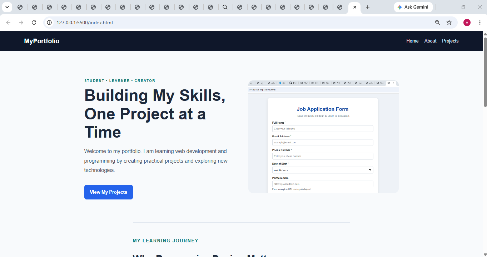
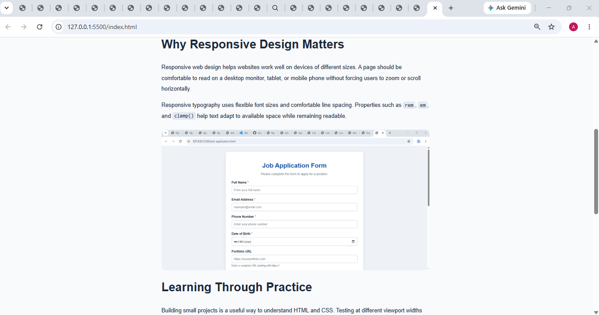
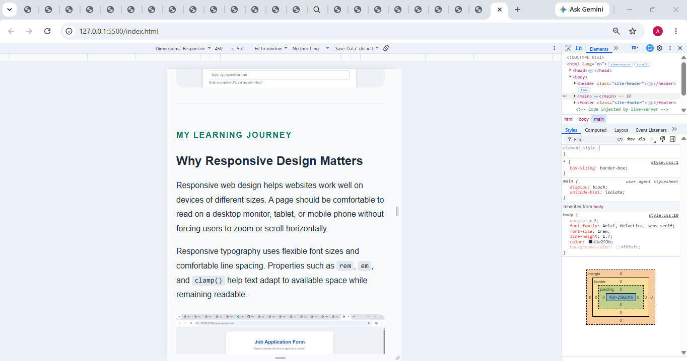
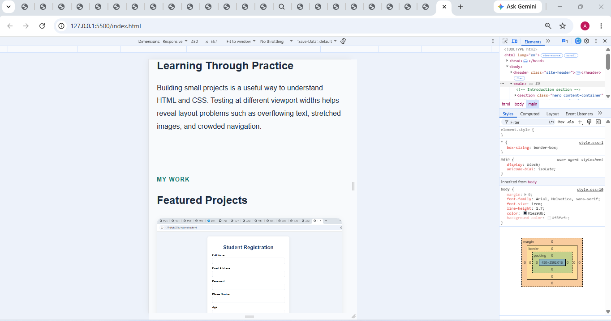

# Assignment 9.2 — Responsive Typography & Images

Aim: To create a responsive portfolio webpage where text, headings, and images adapt to different screen sizes using CSS units such as `rem`, `em`, and `clamp()`.


## 1. Important concepts used

| CSS property        | Purpose                                                             |
| ------------------- | ------------------------------------------------------------------- |
| `rem`               | Sets font sizes and spacing relative to the root font size.         |
| `em`                | Sets values relative to the current element's font size.            |
| `clamp()`           | Sets a minimum, preferred, and maximum value for responsive sizing. |
| `max-width: 100%`   | Prevents images from exceeding their container's width.             |
| `height: auto`      | Preserves an image's natural proportions.                           |
| `max-width: 1100px` | Prevents content from becoming excessively wide on large screens.   |
| `line-height`       | Improves readability by adding vertical space between lines.        |
| `aspect-ratio`      | Maintains a consistent image shape.                                 |
| `minmax(0, 1fr)`    | Allows grid columns to shrink without forcing overflow.             |

For example:

```
h1 {
    font-size: clamp(2rem, 4.5vw, 3.5rem);
}

img {
    max-width: 100%;
    height: auto;
}
```

The heading scales with the viewport but stays within the specified limits. The image shrinks with its container without being stretched.


## 6. Screenshots and submission
## Desktop screenshot




## Mobile screenshot




Result: A responsive portfolio webpage has been created using flexible typography, responsive images, controlled content width, and media queries to improve readability across different screen sizes.